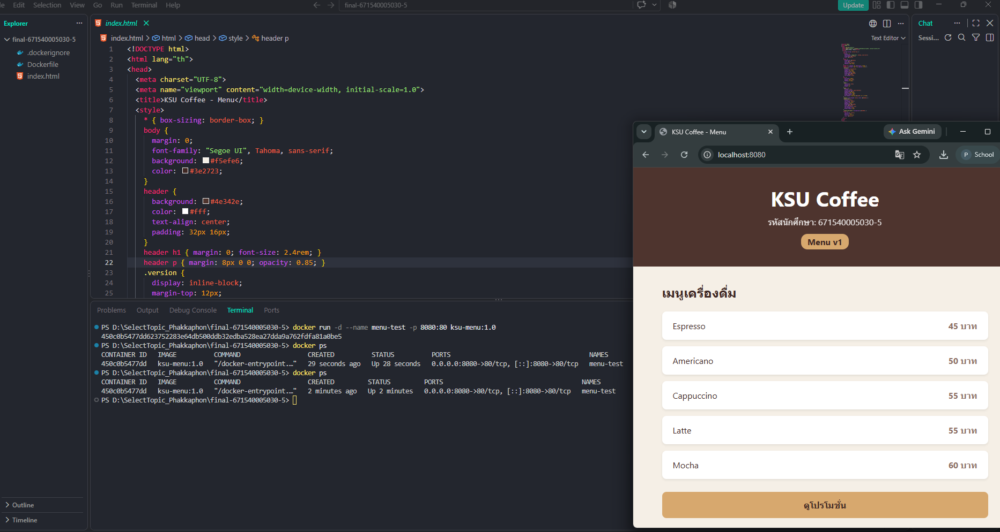
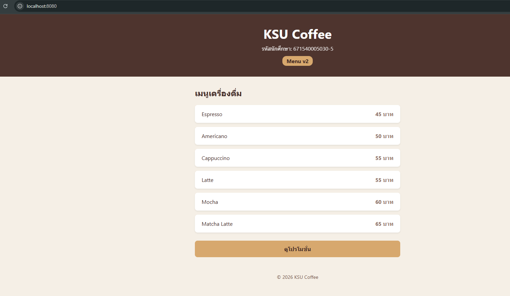
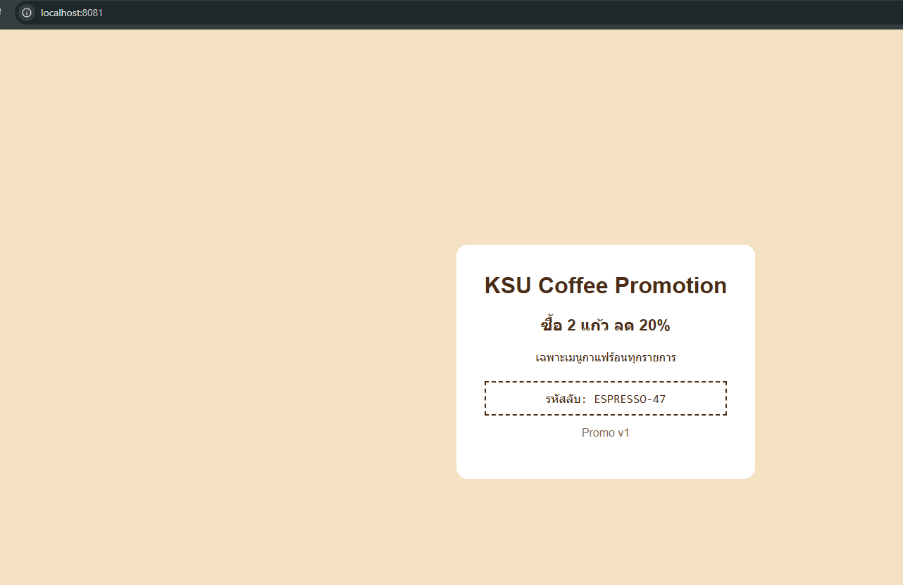

# ANSWER — นายภัคพล ทองจรัส 671540005030-5

## Part A — ข้อมูลจาก image kamthornsa/ksu-promo:1.0

| คำถาม | คำตอบ | คำสั่งที่ใช้ |
| --- | --- | --- |
| Port | 3000 (nginx ฟังที่ 3000 จริง) | `docker image inspect kamthornsa/ksu-promo:1.0 --format '{{json .Config.ExposedPorts}}'` และ `docker run --rm --entrypoint sh kamthornsa/ksu-promo:1.0 -c 'cat /etc/nginx/conf.d/*.conf'` |
| CMD | `ENTRYPOINT ["/docker-entrypoint.sh"]` + `CMD ["nginx","-g","daemon off;"]` | `docker image inspect kamthornsa/ksu-promo:1.0 --format 'Entrypoint={{json .Config.Entrypoint}} Cmd={{json .Config.Cmd}}'` |
| Base image | nginx บน Alpine Linux 3.24.2 (nginx 1.31.6) | `docker history --no-trunc kamthornsa/ksu-promo:1.0` และ `docker run --rm --entrypoint sh kamthornsa/ksu-promo:1.0 -c 'cat /etc/os-release'` |

หลักฐานเพิ่มเติม:

- `ExposedPorts` ให้ `{"3000/tcp":{},"80/tcp":{}}` แต่ `docker history` แสดงว่า `EXPOSE 80` มาจาก layer ของ base image ส่วน `EXPOSE 3000` เป็น layer ที่เจ้าของ image เพิ่มเอง และ `default.conf` ใน image เขียนว่า `listen 3000;` จึงใช้ port 3000
- `/docker-entrypoint.sh` ลงท้ายด้วย `exec "$@"` จึงรัน `nginx -g "daemon off;"` เป็น foreground
- `docker history` เริ่มจาก `alpine-minirootfs-3.24.2` ตามด้วย layer ติดตั้ง nginx และ `docker-entrypoint.sh` ตามลำดับของ official image `nginx:alpine` ส่วน `COPY default.conf` กับ `COPY index.html` เป็น layer ของผู้สร้าง image

## Part B — รหัสลับบนหน้าโปรโมชั่น

`ESPRESSO-47`

(อ่านจาก `http://localhost:8081` หลังรัน `docker compose up -d`)

## Part C — คำถาม

1. หน้าโปรโมชั่นเป็น image สำเร็จรูป ไฟล์เว็บถูกฝังอยู่ใน layer ที่เป็น read-only และเราไม่มีซอร์สหรือ Dockerfile จึงแก้ไม่ได้ ส่วนหน้าเมนูเรามีซอร์สของตัวเอง แก้ไฟล์แล้ว build ใหม่ได้

2. ทดลองแล้ว ไม่ได้หน้าเว็บ เพราะ `docker pull` และ `docker compose up -d` ขึ้น error `kamthornsa/ksu-promo:latest: not found` ไม่ใส่ tag Docker จะใช้ `latest` แต่ repo นี้มีแค่ tag `1.0` ไม่มี `latest`

3. ซ้ายคือ port ของเครื่องโฮสต์ (เปิดผ่าน `localhost:8081`) ขวาคือ port ของ container ที่โปรแกรมข้างในฟังอยู่ ขวาไม่ใช่ 80 เพราะ nginx ใน image นี้ตั้ง `listen 3000;` (ดู Part A)

4. หน้าเว็บจะยังเป็นเวอร์ชันเก่า เพราะ `up -d` ใช้ image ที่ build ไว้แล้วซ้ำ ไม่ build ใหม่ ต้องใช้ `docker compose up -d --build` เพื่อ build image `menu` ใหม่แล้วสร้าง container ใหม่

5. ลิงก์ใช้ `http://localhost:8081` ส่วน `http://promo:3000` ใช้ไม่ได้ เพราะลิงก์ถูกเปิดในเบราว์เซอร์นอก Docker network ที่ไม่รู้จักชื่อ `promo` และ port 3000 เป็น port ภายใน container ที่ไม่ได้ publish ออกมา

## ภาพหน้าจอ

